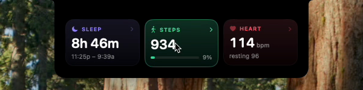
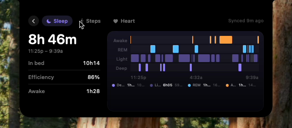
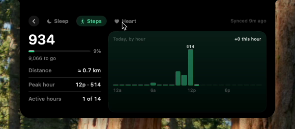
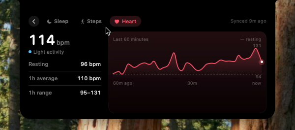

# Macbit Air

Your Fitbit sleep, steps and heart rate in the MacBook notch, from the **Google Health API**.

[](docs/demo.mp4)

## What it does

| Action | What you see |
|---|---|
| Idle | A live dot and your heart rate beside the notch |
| Hover | Cards for **Sleep**, **Steps** and **Heart** |
| Click a card | Details for that metric. Use the tabs to switch and **‹** to go back |
| Right-click | Refresh, Sign in/out, Launch at login, Quit |




| Sleep | Steps | Heart |
|---|---|---|
|  |  |  |
| Stage timeline, in bed, efficiency, awake | Hourly bars, goal, distance, peak hour | Last 60 min, resting, average, range |

Data refreshes every minute. Fitbit syncs to Google about every 15 minutes (or right away
when you open the Fitbit app), and the detail view shows how fresh the data is.

## Setup

**Needs:** macOS 14+, Xcode 16 or the Swift 5.9+ command-line tools, and a Google account linked to your Fitbit.

### 1. Create a Google OAuth client (one time)
1. In the [Google Cloud console](https://console.cloud.google.com/), create a project.
2. **APIs & Services → Library**: enable **Google Health API**.
3. **Google Auth Platform → Audience**: choose **External** and add yourself as a **Test user**.
4. **Data Access → Add scopes**: add
   - `.../auth/googlehealth.activity_and_fitness.readonly`
   - `.../auth/googlehealth.health_metrics_and_measurements.readonly`
   - `.../auth/googlehealth.sleep.readonly`
5. **Clients → Create client → Desktop app**. Copy the Client ID and secret.

### 2. Add your client
```bash
mkdir -p ~/Library/Application\ Support/MacbitAir
cat > ~/Library/Application\ Support/MacbitAir/config.json <<'EOF'
{ "clientId": "YOUR_ID.apps.googleusercontent.com", "clientSecret": "GOCSPX-..." }
EOF
```

### 3. Build and run
```bash
./scripts/build-app.sh
open "build/Macbit Air.app"
```

Hover over the notch and click **Sign in**. On "Google hasn't verified this app", click
**Continue** (it's your own app). Tokens are kept in your Keychain.

## Troubleshooting
- **API 403 MISSING_OAUTH_SCOPE**: add the missing scope, then Sign out and Sign in.
- **Signed out every 7 days**: Google does this while the app is in *Testing*. Set it to
  *In production* on the Audience page (unverified is fine for personal use).
- **API 400 / 404, or a metric stays "—"**: an API name or field differs. They all live in
  `Sources/MacbitAir/Data/GoogleHealthClient.swift` (`HealthDataType` and `HealthParser`);
  compare with <https://developers.google.com/health/filters>.

## Code
```
Sources/MacbitAir/
  Auth/    Google OAuth (PKCE, loopback redirect) and Keychain storage
  Data/    Health API client, parsers, and the 1-minute polling loop
  Notch/   panel, notch shape, hover/detail state
  Views/   cards and detail charts
```
